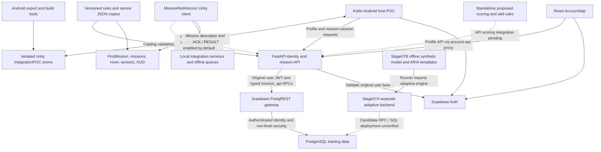
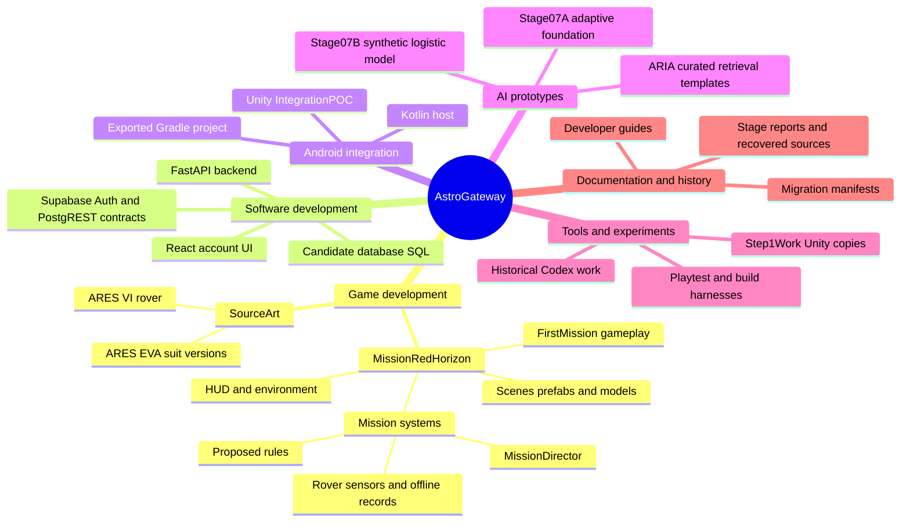

# AstroGateway · Mission Red Horizon

A developer navigation hub for the **Kabylash-Development-SK2LB** private source repository. AstroGateway combines a Unity Mars training prototype, account and mission API code, a React account interface, an Android/Unity host POC, and independent adaptive-training experiments. **Source availability is not a production-readiness claim.**

## 1. Project overview

[MissionRedHorizon](01-Game-Development/MissionRedHorizon) is the primary Unity project: Mars environments, astronaut/rover controls, local mission chains, sensor records, navigation, HUDs and visual prototypes. [FastAPI](02-Software-Development/Backend/astrogateway-api) supplies identity/profile, mission-session, command/report and sensor-record routes; its provider integration uses Supabase Auth and PostgREST. The [web app](02-Software-Development/Web-Dashboards/astrogateway-web) currently starts **AccountApp**, while its separate `App.tsx` contains an earlier 3D Mars preview. The [Android host](02-Software-Development/Integrations/android-unity-host-poc) manages native accounts and launches an isolated Unity integration scene; it is separate from a full FirstMission Android build.

Stage07A adaptive APIs and Stage07B synthetic-data modelling/ARIA retrieval are **experimental and separate from the primary API**. ARES-VI and ARES EVA are rover/suit assets. No deployed A.R.E.S. AI or implemented AG-UMS subsystem was established by this source inspection. Scientific analysis explicitly reports `not_connected`.

## 2. Quick navigation

[Overview](#1-project-overview) · [Repository tree](#3-repository-directory-tree) · [Folder guide](#4-folder-by-folder-guide) · [Architecture](#5-architecture-diagram) · [Mind map](#6-architecture-mind-map) · [Responsibilities](#7-developer-responsibility-and-access-map) · [Terminal navigation](#8-terminal-navigation-guide) · [Setup](#9-setup-and-installation) · [Build/run/test](#10-build-run-and-test) · [Status](#11-source-code-status) · [Contributing](#12-contribution-workflow) · [Troubleshooting](#13-troubleshooting)

| Start here | Source or guide |
|---|---|
| Complete tracked hierarchy | [Repository tree](docs/REPOSITORY_TREE.md) |
| Runtime boundaries and source evidence | [Architecture](docs/ARCHITECTURE.md) |
| Prerequisites and component commands | [Setup guide](docs/SETUP_GUIDE.md) |
| Named team responsibilities | [Developer responsibilities](docs/DEVELOPER_RESPONSIBILITIES.md) |
| Structured team delivery plan | [Team plan](docs/TEAM_PLAN.md) |
| Branches, reviews and terminal usage | [Development workflow](docs/DEVELOPMENT_WORKFLOW.md) |
| Migration scope and checksums | [Migration notes](MIGRATION.md), [import manifest](docs/migration/file-manifest.csv) |
| Primary playable scene | [Mars_FirstMission_Missions.unity](01-Game-Development/MissionRedHorizon/Assets/AstroGateway/FirstMission/Scenes/Mars_FirstMission_Missions.unity) |
| Gameplay / mission code | [FirstMission scripts](01-Game-Development/MissionRedHorizon/Assets/AstroGateway/FirstMission/Scripts), [MissionDirector](01-Game-Development/MissionRedHorizon/Assets/AstroGateway/FirstMission/Scripts/Missions/MissionDirector.cs) |
| Backend / web entry points | [main.py](02-Software-Development/Backend/astrogateway-api/main.py), [src/main.tsx](02-Software-Development/Web-Dashboards/astrogateway-web/src/main.tsx) |
| Android host / Unity bridge | [Kotlin source](02-Software-Development/Integrations/android-unity-host-poc/app/src/main/java/com/sk2lb/astrogateway/poc), [IntegrationPOC](02-Software-Development/Integrations/android-unity-host-poc/UnityIntegrationProject/Assets/AstroGateway/IntegrationPOC) |
| Adaptive / ARIA prototypes | [Stage07A](02-Software-Development/Integrations/experimental/stage07a-adaptive), [Stage07B](02-Software-Development/Integrations/experimental/stage07b-aria) |

## 3. Repository directory tree

This readable selection contains verified paths. The [complete tracked inventory](docs/REPOSITORY_TREE.md) expands every directory and file, including assets and `.meta` files; omitted children below are navigation choices, not missing source.

```text
Kabylash-Development-SK2LB/
├── 01-Game-Development/
│   ├── MissionRedHorizon/
│   │   ├── Assets/
│   │   │   └── AstroGateway/
│   │   │       ├── FirstMission/
│   │   │       │   ├── Config/
│   │   │       │   ├── Editor/
│   │   │       │   ├── Prefabs/
│   │   │       │   ├── Scenes/
│   │   │       │   └── Scripts/
│   │   │       ├── Integration/
│   │   │       ├── MissionIntegration/
│   │   │       ├── MissionRules/
│   │   │       ├── CinematicHUD/
│   │   │       ├── MarsEnvironment/
│   │   │       ├── ProductionVisual/
│   │   │       ├── VehicleShowroom/
│   │   │       └── VisualUpgrade/
│   │   ├── Data/
│   │   ├── Docs/
│   │   ├── Packages/
│   │   └── ProjectSettings/
│   ├── SourceArt/
│   │   ├── 3d-game-assets/
│   │   ├── ARES_EVA_MK1/
│   │   ├── ARES_EVA_MK1_v1_baseline/
│   │   ├── ARES_EVA_MK1_v2/
│   │   ├── ARES_EVA_MK1_v2_gate3_baseline/
│   │   ├── ARES_EVA_MK1_v3/
│   │   └── AstroGatewayAstronaut/
│   └── Experiments/
│       └── MissionRedHorizon_Step1Work/
├── 02-Software-Development/
│   ├── Backend/
│   │   └── astrogateway-api/
│   │       ├── main.py
│   │       ├── database.py
│   │       ├── sensor_records.py
│   │       ├── rules/
│   │       └── tests/
│   ├── Web-Dashboards/
│   │   └── astrogateway-web/
│   │       ├── src/
│   │       ├── public/
│   │       └── package.json
│   ├── Sentinel-Database/
│   └── Integrations/
│       ├── android-unity-host-poc/
│       │   ├── app/
│       │   ├── UnityIntegrationProject/
│       │   ├── unity-export/
│       │   └── tools/
│       └── experimental/
│           ├── stage07a-adaptive/
│           └── stage07b-aria/
├── docs/
│   ├── ARCHITECTURE.md
│   ├── DEVELOPER_RESPONSIBILITIES.md
│   ├── DEVELOPMENT_WORKFLOW.md
│   ├── REPOSITORY_TREE.md
│   ├── SETUP_GUIDE.md
│   ├── TEAM_PLAN.md
│   ├── history/
│   ├── migration/
│   └── reference-material/
├── .gitattributes
├── .gitignore
├── .gitleaks.toml
├── MIGRATION.md
└── README.md
```

## 4. Folder-by-folder guide

“Primary” identifies the main editable source snapshot, not a deployed production service. Full entry-point, dependency and relationship notes are in [Architecture](docs/ARCHITECTURE.md); component commands are in [Setup](docs/SETUP_GUIDE.md).

| Verified directory | Purpose, main files and dependencies | Status / run path |
|---|---|---|
| [MissionRedHorizon](01-Game-Development/MissionRedHorizon) | C# / Unity URP. `Assets`, `Packages`, `ProjectSettings` form the project. `FirstMissionController`, `MissionDirector`, `RoverSensorSuite` coordinate local gameplay. | Primary prototype; open with Unity 6000.6.4f1. |
| [FirstMission](01-Game-Development/MissionRedHorizon/Assets/AstroGateway/FirstMission) | Four scene variants, C# scripts, sensor JSON, rover prefab, editor builders and playtests; depends on environment/visual/HUD assets in the same project. | Primary local gameplay; select a scene explicitly. |
| [Integration](01-Game-Development/MissionRedHorizon/Assets/AstroGateway/Integration) / [MissionIntegration](01-Game-Development/MissionRedHorizon/Assets/AstroGateway/MissionIntegration) | Service interfaces, offline queues, HTTP adapters and integration scene. `IntegrationServices` selects local defaults. | Implemented offline integration; live scene wiring pending. |
| [MissionRules](01-Game-Development/MissionRedHorizon/Assets/AstroGateway/MissionRules) | C# config-driven models and JSON test vectors; mirrors backend rule configuration. | Proposed rules; API scoring not connected. |
| [Visual and environment modules](01-Game-Development/MissionRedHorizon/Assets/AstroGateway) | `Environment`, `Greybox`, `MarsEnvironment`, `MarsVisualPolish`, `NativeControlSlice`, `ProductionVisual`, `CinematicHUD`, `Stage08B/C/C1`, `VehicleShowroom`, `VisualUpgrade`, `Verification`. Scenes, materials, models, shaders and editor tools. | Prototype iterations within the primary Unity project. |
| [SourceArt](01-Game-Development/SourceArt) | Python/Blender generators, OBJ/GLB/FBX models, materials, prefabs, suit v1/v2/v3 and baselines. `3d-game-assets/build_ares_vi_aaa_production.py` is an authoring entry point. | Versioned art sources; regenerate only in an isolated working copy. |
| [Step1Work experiments](01-Game-Development/Experiments/MissionRedHorizon_Step1Work) | Separate Unity projects (`Lab`, `Lab2`, `FirstMissionAndroid`, `MacBuild/Project`, `GameplayVideo/Project`, `VisualUpgradeMacBuild/Project`), shell/Swift harnesses, reports/backups. | Experimental/historical; not the default editing target. |
| [Backend](02-Software-Development/Backend/astrogateway-api) | Python FastAPI / httpx / uvicorn. `main.create_app`, `Database` RPC adapter, `sensor_records.register`, `rules/`, pytest tests. | Primary API source; live provider/RLS configuration unverified. |
| [Web app](02-Software-Development/Web-Dashboards/astrogateway-web) | React / TypeScript / Vite / Supabase JS. `src/main.tsx` renders `AccountApp`; profile requests target FastAPI. Three.js preview remains in `App.tsx`. | Account UI implemented; full mission dashboard not established. |
| [Sentinel-Database](02-Software-Development/Sentinel-Database) | SQL identity/mission-session candidate and admin template. Revised SQL and later candidates live in stage/game docs. | Historical candidate; **not an automatic migration sequence**. |
| [Android host](02-Software-Development/Integrations/android-unity-host-poc) | Kotlin Activity host, Supabase Kotlin/OkHttp, private Unity Activity, C# bridge and Gradle export. `MainActivity`, `AuthCoordinator`, `SecureSessionStore`, `PocUnityActivity`. | Integration POC; run export/build tools on a copy; device behavior NOT TESTED here. |
| [Stage07A](02-Software-Development/Integrations/experimental/stage07a-adaptive) | Separate FastAPI snapshot, `adaptive/engine.py`, `/ai` endpoints and candidate SQL. | Experimental; not mounted in the primary API. |
| [Stage07B](02-Software-Development/Integrations/experimental/stage07b-aria) | Python synthetic dataset, five-head logistic regression, curated English/Tamil retrieval templates, privacy and witness checks. | Offline experiment; no deployed AI service or measured astronaut-skill claim. |
| [History](docs/history) | Codex outputs, unique work source, recovered archive files and project-backup differences. | Historical reference; may require its original layout. |
| [Migration](docs/migration) / [references](docs/reference-material) | Import hashes/status and design reference documents. | Reference; migration manifest is a fixed import snapshot. |
| [Repository controls](.gitattributes) | LFS attributes, ignore rules and Gitleaks configuration. | Maintainer-owned repository configuration; no CI or CODEOWNERS file is currently tracked. |

## 5. Architecture diagram

Solid arrows represent source-confirmed code relationships, not proof of a live deployment. Dashed arrows are explicitly pending integrations/deployments. [Source evidence and API map](docs/ARCHITECTURE.md).



<details>
<summary>Mermaid diagram and editable source</summary>



</details>

## 6. Architecture mind map

This is a repository organization map, not a runtime call graph.



<details>
<summary>Mermaid diagram and editable source</summary>



</details>

SVG previews above are generated from the same Mermaid source (validated with Mermaid 12.2). Both minimal and full diagrams encountered GitHub’s “Unable to render rich display” error in the preview check; the SVGs provide a readable fallback. Expand the Mermaid sections to inspect the editable diagrams. No renderer/security settings were changed.

## 7. Developer responsibility and access map

| Team member | Role supplied by Kapilash | Main responsibility |
|---|---|---|
| **Kapilash** | Lead game developer | Build the Unity game, gameplay and mission systems; integrate accepted art and software changes into a playable experience. |
| **Bawantha** | Software developer | Develop software services and integrations; proposed work areas are backend, web, database contracts and Android integration. |
| **Layanthini** | 3D objects / character developer; planning and research contributor | Create 3D objects and characters; also contribute project ideas, data gathering, PPTs and documents with Shinojan. |
| **Shinojan** | Project planning, ideas, data gathering, PPTs and documents | Work with Layanthini on the project brief, references, requirements, presentation and documentation. |
| **Jkutralan** | Innovation contributor | Suggest innovative ideas and explain their user benefit; help the team compare and refine concepts before implementation. |

Layanthini and Shinojan share project planning, research/data gathering, ideas, PPTs and documents. Layanthini also develops 3D objects and characters. The [structured team plan](docs/TEAM_PLAN.md) proposes milestone order, workstreams and handoffs around those roles; the [responsibility guide](docs/DEVELOPER_RESPONSIBILITIES.md) maps technical review areas.

These names and roles were supplied by Kapilash; detailed task allocation and cadence remain proposals. Repository write access is not per-folder write access. CODEOWNERS routes reviews and does not impose folder access restrictions. No collaborator permissions, CODEOWNERS or enforcement policy is changed by this plan. See [GitHub CODEOWNERS documentation](https://docs.github.com/en/repositories/managing-your-repositorys-settings-and-features/customizing-your-repository/about-code-owners).

## 8. Terminal navigation guide

Run from your clone; paths below are repository-relative. `tree` is optional: `find` and `git ls-files` work without it.

```bash
pwd
ls
ls -lah
cd 01-Game-Development/MissionRedHorizon
find Assets/AstroGateway -name '*.cs' -type f
cd ../..
find 02-Software-Development/Backend -name '*.py' -type f
find 02-Software-Development/Integrations/android-unity-host-poc/app -name '*.kt' -type f
find 02-Software-Development/Web-Dashboards -name '*.tsx' -not -path '*/node_modules/*'
git ls-files '01-Game-Development/*' '02-Software-Development/*'
git status
git log --oneline -10
git pull --ff-only origin main
git lfs pull
# Optional, if tree is installed:
tree -a -L 5 -I '.git|Library|Temp|node_modules|.venv'
```

Only pull while on the intended branch with a clean working tree. `git lfs pull` restores binary source assets for the checked-out revision. [More navigation examples](docs/DEVELOPMENT_WORKFLOW.md#terminal-navigation).

## 9. Setup and installation

| Component | Source-verified prerequisite |
|---|---|
| Repository | Git + Git LFS; repository access through your GitHub account |
| Unity | **6000.6.4f1**, URP **17.6.0**, Input System **1.20.0**, Test Framework **1.8.0** from project configuration |
| Backend | Python; no repository-wide interpreter pin. Historical runner used 3.14. FastAPI **0.143.0**, uvicorn **0.54.0**, httpx **0.28.1**; pytest dependencies in `requirements-dev.txt` |
| Web | npm with committed lockfile. Node **24.15+ within 24.x** meets the inspected Vite/Vitest/jsdom engine constraints; no runtime version file is pinned. Lockfile resolves Vite 8.3.3, Vitest 5.0.3, jsdom 30.1.2 |
| Android POC | SDK **36**, min SDK **26**, build-tools **36.0.0**, ARM64, NDK **27.2.12479018**, JDK **17**, Gradle **9.3.1**, AGP **9.1.1**; Android Studio optional |
| Source art | Python; Blender `bpy` for Blender-specific scripts. Blender version is not pinned |

Use component-local `.env.example` / `auth.local.properties.example` templates and your approved test configuration. Never put database, signing or service-role secrets into the API process or public web/Android configuration. [Detailed setup and configuration gates](docs/SETUP_GUIDE.md).

## 10. Build, run and test

**NOT TESTED in this documentation update:** application installation, compilation, runtime and tests. Commands below are verified against source entry points, not certified successful executions.

| Component | Entry point / commands | Caveat |
|---|---|---|
| Unity gameplay | Open `MissionRedHorizon` in the pinned editor; use **AstroGateway → Open Missions Scene**, then Play | Default Build Settings still names `Assets/Scenes/SampleScene.unity`; choose the intended mission scene. |
| Unity playtest | **AstroGateway → First Mission Playtest** | Graphical Editor harness; mock uploads, no live backend proof. |
| Backend | In API directory: `python3 -m venv .venv`, install `requirements-dev.txt`, `python -m pytest tests -q`, `python run_local.py` | Configure owner-only `.env`; tests include an original-layout catalog path; live isolation/RPC setup still required. |
| Web | In web directory: `npm ci`, `npm run dev`, `npm test`, `npm run lint`, `npm run build` | Main entry is AccountApp; default profile proxy targets loopback port 8000. |
| Android POC | In a working copy of host directory: `mkdir -p logs`, `zsh tools/export.sh`, `zsh tools/build.sh` | Mac tool paths are hard-coded; export regeneration required for missing generated IL2CPP toolchain inputs. |
| Device smoke | `python3 tools/device_smoke.py` from host working copy | Installs/launches on one authorized unlocked ARM64 device; not executed here. |
| Stage07A / Stage07B | Isolated pytest instructions in [Setup](docs/SETUP_GUIDE.md#experimental-prototypes) | Separate PYTHONPATH/environment; historical runners are not portable turnkey launchers. |

See [Setup](docs/SETUP_GUIDE.md) for complete working directories, environment variables and build cautions.

## 11. Source code status

| Area | Implemented in source | Pending / incomplete / unverified |
|---|---|---|
| Unity gameplay | Local rover/astronaut control, mission chain, HUD variants, navigation and sensor record store | Current-clone compilation/device/playtest NOT TESTED; API adapters not enabled by default |
| API | Profile, mission sessions/commands/reports, sensor-record endpoints, bearer verification and RPC adapter | Hosted SQL/RLS, configuration, isolation and live end-to-end execution unverified |
| Scientific analysis | Explicit `not_connected` interface/status | No connected scientific analysis model |
| Rules / assessment | Config-driven oxygen/weather/scoring/skills engines and tests | Defaults labelled PROPOSED; API scores/skill levels remain unset, recommendations placeholder |
| Web | Account authentication/profile interface; separate 3D preview source | Complete mission-control dashboard and Unity/web handoff not established |
| Android | Account coordinator, secure store, launch descriptor and Unity ACK/RESULT bridge | Authenticated device lifecycle and full-game integration unverified; bridge result is not a training score |
| Stage07A | Adaptive foundation API/engine and candidate SQL | Separate experiment, no primary-service integration verified |
| Stage07B / ARIA | Synthetic logistic model, fixed bilingual retrieval, privacy/witness prototypes | Not an LLM; science-data authorization, Tamil parity and production deployment not established |
| AG-UMS / A.R.E.S. AI | No implemented subsystem identified under those product names | Planned/unverified; ARES assets do not imply an AI system |
| History / tooling | Source snapshots, prior reports, shell/Swift/Python utilities | Historical PASS statements are not tests rerun against this clone; no tracked CI workflow |

## 12. Contribution workflow

Clone with your authorized GitHub account, pull LFS objects, branch from current `main`, modify the appropriate module, run relevant checks, commit a focused change, push your feature branch and open a pull request. Request cross-module review for authentication, JSON contracts, SQL, Unity GUIDs and native bridge changes. [Exact commands and review checklist](docs/DEVELOPMENT_WORKFLOW.md).

Keep the repository private. This guide does not change collaborators, branch rules, secrets, deployment settings or folder permissions. Preserve historical evidence and the migration snapshot manifest; update the live repository tree when tracked paths change.

## 13. Troubleshooting

| Symptom | Source-grounded check |
|---|---|
| Models/textures are tiny pointer text or missing | Run `git lfs install`, `git lfs pull`, `git lfs fsck`; check LFS access/quota errors. |
| Unity opens the sample scene | Explicitly open the linked FirstMission scene or use the Open Missions Scene menu; do not assume Build Settings selects it. |
| Unity package/shader errors | Match editor and URP versions, restore LFS, preserve `.meta` files and allow package resolution. |
| Backend startup is refused | Check `.env` ownership/mode, complete approved test settings, retired DB settings and admin-secret isolation. Never bypass the guard by relocating secrets beside the service. |
| Backend catalog test fails on another clone | `tests/test_sensor_records.py` references the original home-directory Unity location. Documented portability issue; do not treat a missing external path as a provider failure. |
| Web account service is unavailable | Configuration readiness pins the approved provider URL and publishable-key shape; check `.env.local`, callback configuration and the `/account-api` proxy/backend. |
| Node install reports engine errors | Use a Node release satisfying locked package engines; `npm ci` preserves the lockfile. |
| Android Gradle/IL2CPP files are missing | Regenerate the integration export with the matching Unity Android modules; imported cache/toolchain directories were excluded. |
| Android build works only on the original Mac | Build/export scripts, exported NDK settings and historical sandbox profiles embed machine-specific paths. Review in a copy; no portability refactor was performed. |
| ARIA runner cannot find protocol/datasets | Its parent-relative historical layout differs from migrated history locations. Follow the prototype notes rather than blindly running the old runner. |

[Detailed setup/troubleshooting](docs/SETUP_GUIDE.md#troubleshooting) · [Architecture and known limits](docs/ARCHITECTURE.md#known-limits)
