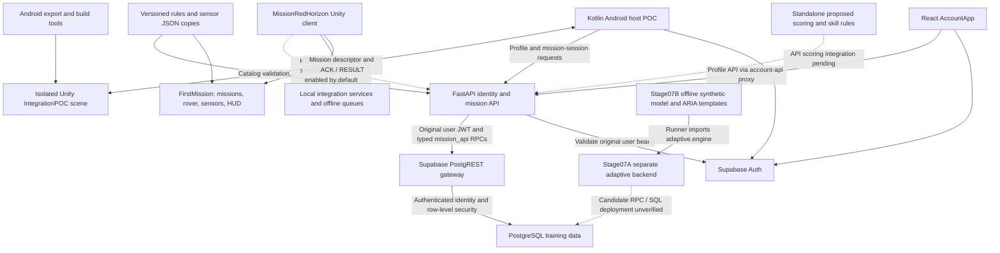
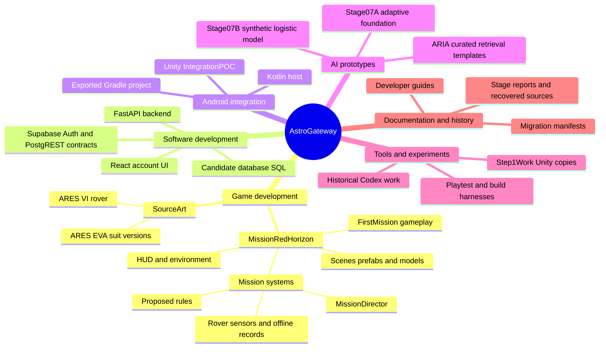

# AstroGateway architecture and module reference

[README](../README.md) · [Setup](SETUP_GUIDE.md) · [Tracked tree](REPOSITORY_TREE.md)

## Scope and evidence

Inspected against fetched `main` source on 2026-10-25. “Implemented” means source exists; it does not certify deployment, physics accuracy, authorization of external data, successful compilation or current device operation. Historical reports remain unchanged. The primary editing target is [MissionRedHorizon](../01-Game-Development/MissionRedHorizon) plus [primary API](../02-Software-Development/Backend/astrogateway-api), [web](../02-Software-Development/Web-Dashboards/astrogateway-web) and [Android host](../02-Software-Development/Integrations/android-unity-host-poc). Parallel Unity copies and Stage07 experiments are separate snapshots.

## System diagram

Solid links are code relationships. Dashed links identify incomplete integration/deployment; the diagram does not assert that the external services are configured.

Mermaid diagram and editable source

## Repository mind map

Mermaid diagram and editable source

Diagrams use standard `flowchart TD` and indentation-based `mindmap` fences, without external plugins, icons or initialization directives. GitHub supports Mermaid fenced blocks; see [GitHub diagram documentation](https://docs.github.com/en/get-started/writing-on-github/working-with-advanced-formatting/creating-diagrams).

SVG previews above are generated from the same Mermaid source (validated with Mermaid 12.2). Both minimal and full diagrams encountered GitHub’s “Unable to render rich display” error in the preview check; the SVGs provide a readable fallback. Expand the Mermaid sections to inspect the editable diagrams. No renderer/security settings were changed.

## Relationship evidence

| Diagram edge / boundary | Verified source |
|---|---|
| Unity gameplay to local mission/sensor systems | [FirstMissionController.cs](../01-Game-Development/MissionRedHorizon/Assets/AstroGateway/FirstMission/Scripts/FirstMissionController.cs), [MissionDirector.cs](../01-Game-Development/MissionRedHorizon/Assets/AstroGateway/FirstMission/Scripts/Missions/MissionDirector.cs), [RoverSensorSuite.cs](../01-Game-Development/MissionRedHorizon/Assets/AstroGateway/FirstMission/Scripts/RoverSensorSuite.cs) |
| Offline service defaults | [LocalServices.cs](../01-Game-Development/MissionRedHorizon/Assets/AstroGateway/Integration/Local/LocalServices.cs) initializes `IntegrationServices` with offline identity, local mission sessions and provisional assessment. FirstMission sensor upload defaults to a not-connected implementation. |
| Conditional Unity HTTP connection | [HttpMissionSessionService.cs](../01-Game-Development/MissionRedHorizon/Assets/AstroGateway/Integration/Http/HttpMissionSessionService.cs) and `HttpSensorRecordUploader` in [FirstMissionData.cs](../01-Game-Development/MissionRedHorizon/Assets/AstroGateway/FirstMission/Scripts/FirstMissionData.cs) implement requests; this is not default scene wiring. |
| Account web entry / API calls | [main.tsx](../02-Software-Development/Web-Dashboards/astrogateway-web/src/main.tsx) renders AccountApp; [client.ts](../02-Software-Development/Web-Dashboards/astrogateway-web/src/account/client.ts) creates Supabase PKCE client and calls `/v1/me` / display-name endpoint; [vite.config.ts](../02-Software-Development/Web-Dashboards/astrogateway-web/vite.config.ts) proxies account-api. |
| Android account / API / Unity launch | [AuthCoordinator.kt](../02-Software-Development/Integrations/android-unity-host-poc/app/src/main/java/com/sk2lb/astrogateway/poc/AuthCoordinator.kt), [MainActivity.kt](../02-Software-Development/Integrations/android-unity-host-poc/app/src/main/java/com/sk2lb/astrogateway/poc/MainActivity.kt), [PocUnityActivity.kt](../02-Software-Development/Integrations/android-unity-host-poc/app/src/main/java/com/sk2lb/astrogateway/poc/PocUnityActivity.kt) |
| Native bridge receiver | [AstroGatewayPocBridge.cs](../02-Software-Development/Integrations/android-unity-host-poc/UnityIntegrationProject/Assets/AstroGateway/IntegrationPOC/AstroGatewayPocBridge.cs) receives a mission descriptor and returns integration acknowledgements/results. |
| API bearer verification / data gateway | [main.py](../02-Software-Development/Backend/astrogateway-api/main.py) defines `AuthVerifier`, `Settings`, `create_app`; [database.py](../02-Software-Development/Backend/astrogateway-api/database.py) forwards the original bearer to typed PostgREST RPCs with `mission_api` profiles. |
| Versioned shared JSON | [Unity mission rules](../01-Game-Development/MissionRedHorizon/Assets/AstroGateway/MissionRules/Config/mission_rules_v1.json) equals [backend mission rules](../02-Software-Development/Backend/astrogateway-api/rules/mission_rules_v1.json); [Unity sensor catalog](../01-Game-Development/MissionRedHorizon/Assets/AstroGateway/FirstMission/Config/sensor_catalog_v1.json) equals [backend sensor catalog](../02-Software-Development/Backend/astrogateway-api/rules/sensor_catalog_v1.json) at inspection. These are duplicate versioned files, not a runtime synchronization service. |
| Proposed assessment | [rules modules](../02-Software-Development/Backend/astrogateway-api/rules) expose config-driven scoring/life support/weather/skills. API responses still carry pending/placeholder assessment, rather than invoking those scoring engines. Catalog loading used by sensor validation is distinct from deploying scoring. |
| Stage07A separate service | [adaptive/api.py](../02-Software-Development/Integrations/experimental/stage07a-adaptive/backend/adaptive/api.py) mounts `/ai` routes into its own backend; [candidate SQL](../02-Software-Development/Integrations/experimental/stage07a-adaptive/database/007a_local_adaptive_candidate.sql) is not proof of hosted deployment. |
| Stage07B runner to Stage07A engine | [run_local.py](../02-Software-Development/Integrations/experimental/stage07b-aria/run_local.py) imports `adaptive.engine.simulate`; additional PYTHONPATH and historical file layout are required. |
| Android generation tooling | [export.sh](../02-Software-Development/Integrations/android-unity-host-poc/tools/export.sh), [build.sh](../02-Software-Development/Integrations/android-unity-host-poc/tools/build.sh), [prepare_host.py](../02-Software-Development/Integrations/android-unity-host-poc/tools/prepare_host.py) operate on the isolated Unity integration project and Gradle export. |

## Primary Unity project

The project root is [01-Game-Development/MissionRedHorizon](../01-Game-Development/MissionRedHorizon). Open that folder, not the repository root. `Assets` contains source and GUID-bearing `.meta` files; `Packages` declares dependencies; `ProjectSettings` pins editor/build configuration. `Data/Plugins` retains imported Burst/WebGL output; it is not the main gameplay source. The [project docs](../01-Game-Development/MissionRedHorizon/Docs) preserve stage-specific design/evidence and SQL proposals.

### Scene and code map

| Area | Actual source / scenes | Role |
|---|---|---|
| FirstMission scenes | [Scenes](../01-Game-Development/MissionRedHorizon/Assets/AstroGateway/FirstMission/Scenes): `Mars_FirstMission_v1`, `Mars_FirstMission_HUDv2`, `Mars_FirstMission_Explorer`, `Mars_FirstMission_Missions` (`.unity`) | Separate base, premium HUD, explorer and mission-chain variants. |
| Core gameplay | [Scripts](../01-Game-Development/MissionRedHorizon/Assets/AstroGateway/FirstMission/Scripts): `FirstMissionController`, `FirstMissionControlLayer`, `FirstMissionCameraRig`, `AresRoverPresentation` | Local gameplay/control/presentation. |
| Mission chain | [Scripts/Missions](../01-Game-Development/MissionRedHorizon/Assets/AstroGateway/FirstMission/Scripts/Missions): `MissionDirector`, `MissionStructure`, `GeneratorState`, `ChargingPadState`, `CheckpointState`, `MissionFx` | Objectives, structures and local mission progression. |
| Navigation / HUD | [Nav](../01-Game-Development/MissionRedHorizon/Assets/AstroGateway/FirstMission/Scripts/Nav) and [HUD](../01-Game-Development/MissionRedHorizon/Assets/AstroGateway/FirstMission/Scripts/HUD) | Traversability/navigation, map, explorer, premium and mission HUDs. |
| Sensor data | `RoverSensorSuite`, `FirstMissionData`, `Config/sensor_catalog_v1.json` | Simulated measurements, record validation, bounded local storage, explicit upload state and analysis-not-connected seam. |
| Prefabs / models | [FirstMission prefabs](../01-Game-Development/MissionRedHorizon/Assets/AstroGateway/FirstMission/Prefabs), [ARES_VI](../01-Game-Development/MissionRedHorizon/Assets/AstroGateway/VehicleShowroom/ARES_VI), [MarsEnvironment models](../01-Game-Development/MissionRedHorizon/Assets/AstroGateway/MarsEnvironment/Models), [VisualUpgrade meshes](../01-Game-Development/MissionRedHorizon/Assets/AstroGateway/VisualUpgrade/Meshes) | Runtime/presentation assets; keep sidecar GUIDs. |
| Integration seam | [Integration](../01-Game-Development/MissionRedHorizon/Assets/AstroGateway/Integration); [Mars_MissionIntegration_v1.unity](../01-Game-Development/MissionRedHorizon/Assets/AstroGateway/MissionIntegration/Scenes/Mars_MissionIntegration_v1.unity) | Contracts, local implementations, adapters and provisional connection status panel. |
| Authoring / verification | [FirstMission Editor](../01-Game-Development/MissionRedHorizon/Assets/AstroGateway/FirstMission/Editor); [Verification/Editor](../01-Game-Development/MissionRedHorizon/Assets/AstroGateway/Verification/Editor) | Scene builders, playtests, layout probes and build helpers. Some tools alter generated scenes/settings. |

Other tracked modules include Greybox, Environment, MarsEnvironment, MarsVisualPolish, NativeControlSlice, ProductionVisual, CinematicHUD, Stage08B, Stage08C, Stage08C1, VehicleShowroom and VisualUpgrade. They are related prototype iterations/assets inside one project, not separately deployed services. The complete tree enumerates their scripts, scenes, shaders, models, prefabs, settings and materials.

## Primary API and database contracts

`main.py` constructs FastAPI through `create_app`. Settings enforce HTTPS provider origins and reject retired direct database settings. `AuthVerifier` consults provider Auth and checks the bearer’s identity/session/claims. `Database` sends approved RPC payloads through PostgREST; it does not create a raw SQL pool. User ownership is checked before returning profiles/session data. These code checks do not establish that a remote schema/RLS configuration is correct.

| HTTP surface | Implementation / purpose |
|---|---|
| `GET /health` | Configuration presence; not live schema/readiness proof. |
| `GET /v1/me`, `POST /v1/me/display-name` | Verified profile retrieval/update. |
| `POST /v1/mission-sessions` | Initialize an authenticated mission session. |
| `POST /v1/mission-sessions/{session_id}/complete` | Complete session; Android integration check is not a scientific training score. |
| `POST /v1/mission-sessions/{session_id}/commands` | Bounded semantic commands with revisions/idempotency. |
| `GET /v1/mission-sessions/{session_id}`, `GET /v1/reports/{session_id}` | Owned session state / evidence report. |
| `GET /v1/skills`, `GET /v1/recommendations` | Evidence summary / labelled placeholder recommendation. |
| `POST /v1/mission-sessions/{session_id}/sensor-records` | `sensor_records.register`: validate and persist through repository contract. |
| `GET /v1/science/analysis-status` | Explicit analysis interface with no connected model. |
| `POST /v1/auth-session/revoke` | Record session revocation. |

### SQL is not one deployment chain

[Sentinel-Database](../02-Software-Development/Sentinel-Database) holds an earlier identity/session SQL candidate and admin template. The API README supersedes old Stage05B/05B1 database instructions with [Stage05B2 revised SQL manifest](../docs/history/codex-outputs/Stage05B2/Revised_Final_SQL_Manifest.md). Later candidates are [Step3 mission command SQL](../01-Game-Development/MissionRedHorizon/Docs/Step3/SQL/005_mission_commands_reports.sql), [FirstMission sensor SQL](../01-Game-Development/MissionRedHorizon/Docs/FirstMission/SQL/006_sensor_records.sql) and the separate Stage07A candidate. Review dependencies, schemas, fresh-install/collision constraints and rollback notes individually. No migration runs at API startup; this documentation task applied no SQL.

The intended external database boundary is Supabase Auth → trusted PostgREST identity → PostgreSQL row-level security. Keep admin credentials/signing keys outside the application process filesystem. The existing guard only checks one known relative admin-file location; it is diagnostic, not complete isolation, and the migrated folder layout differs from the original layout.

## Web and Android

The web entry is [src/main.tsx](../02-Software-Development/Web-Dashboards/astrogateway-web/src/main.tsx) → AccountApp/AccountContext. Authentication uses Supabase JS PKCE; profile requests carry the user bearer to the API. `configurationReady` checks a fixed approved provider URL and publishable-key shape, so arbitrary new projects are not automatically supported by environment substitution. Listed dependencies do not prove all features are used.

The Android host uses Supabase Kotlin auth, `SecureSessionStore`, native API requests and a retained Unity Activity in a separate process. `MainActivity` is the exported launcher; `PocUnityActivity` is private. Unity receives mission/session/user identifiers via a versioned descriptor, not the account bearer. Source includes ready/ACK/RESULT and return/relaunch logic. The IntegrationPOC scene is an isolated test scene, not the complete Mars game. The host README’s early “No backend/Auth services” statement describes its initial POC and is superseded by the tracked AuthCoordinator code; historical text was preserved.

## Art, tools and historical experiments

[SourceArt](../01-Game-Development/SourceArt) contains ARES-VI rover authoring assets/generators and EVA suit v1/v2/v3 plus baselines. The v1 `unity_package` has prefab/scene/controller source; v3 contains later models/renders/textures, not an equivalent tracked Unity package. Importing art does not automatically attach game behavior. Blender-dependent scripts require `bpy`; generator versions and cross-platform behavior are unverified.

[Step1Work](../01-Game-Development/Experiments/MissionRedHorizon_Step1Work) contains six standalone Unity copies plus `FirstMission` shell/Swift tools, `staging` source, `harness_backup`, `backup` differences and historical `results`. Treat these as experiments. Their project settings can differ from the primary project. [Codex work](../docs/history/codex-work-source/work) contains unique authoring/experimental source, not one runnable application. Recovered archive content is partial historical material, not a replacement project root.

## AI prototypes

Stage07A is its own FastAPI snapshot with `adaptive.engine`, schemas/repository and `/ai/telemetry`, `/ai/skills/me`, `/ai/mission/recommend`, `/ai/training-plan/me`, `/ai/debrief`. It relies on separately reviewed RPC/SQL contracts and local fixture infrastructure. It is not imported by the primary backend.

Stage07B includes synthetic datasets, stdlib five-head logistic regression, curated English/Tamil retrieval templates (`stage07b/aria.py`), consent/export/delete helpers, ingest provenance gates and a local OpenSSL witness verification prototype. These are not a deployed LLM, an independently validated skill assessment or a connected scientific inference service. Tamil fluency/parity remains blocked in its own evaluation. `run_local.py` expects sibling historical protocol/Evidence/Datasets locations; those artifacts were migrated under a different history prefix. `offline.sb` contains original Mac sandbox paths and must not be reused unchanged elsewhere.

## Known limits

- The primary Unity Build Settings still enables SampleScene; explicit scene selection is necessary.
- Primary Unity session/sensor connections default offline; HTTP source is not proof of approved live scene wiring.
- Rules JSON is present in both clients; duplicated copies can drift. Scoring/skill API integration remains proposed.
- No connected scientific model, implemented AG-UMS subsystem or deployed A.R.E.S. AI was verified.
- Test code includes original-layout paths; Android export/build scripts and sandbox profiles include Mac-specific paths. This task changes documentation only.
- Unity-generated IL2CPP toolchain/cache directories were excluded from migration. Re-export using the matching editor before rebuilding the Android host.
- Historical stage results and migration integrity checks do not establish a fresh successful application build. No application tests, live requests, database migrations or device installation were performed in this documentation task.
- No tracked CI workflow/CODEOWNERS exists; no branch protection, collaborator permission or deployment change is implied.
