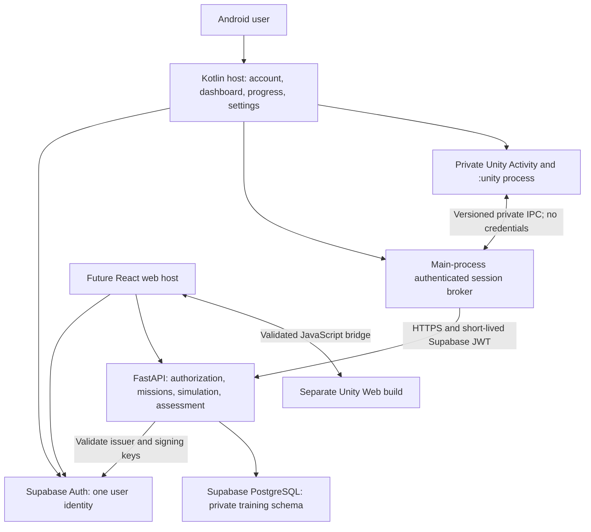

# Unified system and platform decision

## Decision and boundaries

Use **Kotlin Android host + Unity as a Library + FastAPI + Supabase**. Package the dashboard and Mars trainer under one application ID and one installation. Unity opens full-screen inside an Activity in the same app, with its runtime in a private `:unity` process. The dashboard and authentication broker stay in the main process.

The Unity process boundary is a lifecycle choice, not an anti-cheat or secret-isolation guarantee: both processes belong to the same installed app. Keep secrets out of the game to reduce accidental leakage and avoid two refresh coordinators.

| Component | Responsibility | Does not own |
|---|---|---|
| Android host | Signup, signin, reset, dashboard, profile, secure session, navigation, preferences | Mission scoring rules |
| Unity | Movement, camera, scene interactions, local visual previews, mission presentation | Password verification, permanent credentials, authoritative score |
| Private broker | Allowed mission calls, refreshed authorization, IPC responses | Arbitrary proxy requests chosen by Unity |
| FastAPI | Ownership checks, state transitions, deterministic resource model, rubric, recommendations, reports | A second account/password system |
| Supabase | Central Auth and persistent PostgreSQL data | Automatically trusting client scores |

## Comparison for this seven-day sprint

| Dimension | React Native + Unity library | Native Kotlin + Unity library — selected | Single Unity Android application — contingency |
|---|---|---|---|
| Integration | RN/native/Unity boundaries; wrapper compatibility must be proven | Android/Unity boundary; official native example provides a starting point | Avoids host/runtime integration, but host UI must be built in Unity |
| Build | RN Gradle/JS tooling plus Unity export and bridge plugins | One Android Gradle host plus Unity export; still sensitive to AGP versions | Unity Android export; Android support still required |
| Performance | Extra JS runtime and bridge overhead; must measure | No additional JS runtime; Unity remains the main GPU/RAM cost | Unity resident during dashboards unless scene/resource management changes |
| Auth handoff | Native secure storage and Unity bridge still needed | One native Auth coordinator and private broker | One separate Auth service inside the app; Unity never verifies passwords |
| Navigation | RN routing plus Android Unity Activity lifecycle | Small native screen stack plus explicit game Activity | Unity screen/scene navigation |
| Lifecycle | RN and Unity state restoration; third-party adapter risk | Main host survives tested Unity process exit; IPC reconnect required | Fewer integration boundaries, all app state shares runtime |
| Maintenance | More frameworks and compatibility matrices | Android-specific UI; small, explicit bridge | Simpler packaging, weaker reuse of host UI on web |
| Future web | Share some TypeScript logic; RN views are not existing Vite DOM views | Share API contracts, content and design; rebuild host screens in React | Export game for web; separate web host still needed |

This is a judgment based on current project state, not a benchmark. The React project is a small Three.js scene without implemented account/dashboard features, so switching to React Native would not preserve a substantial existing host application. There is no verified RN wrapper in this proposal for Unity 6000.6.4f1 and its current Android toolchain. The [React Native integration guide](https://reactnative.dev/docs/integration-with-existing-apps.html) describes native application integration, not automatic Unity embedding.

The [Unity Android library documentation](https://docs.unity.com/en-us/engine/6000.6/manual/platform-specific/android/developing/unityasa-library) supports native embedding, limits the ordinary runtime to full-screen rendering and one instance, and distinguishes unloading from quitting. The [official Unity example](https://github.com/Unity-Technologies/uaal-example/blob/master/docs/android.md) uses a separate Unity Activity/process. It is a reference architecture, not a tested drop-in solution for this project.

## Integration plan

1. After approval, install Android Build Support with the matching SDK/NDK/JDK. Export a minimal scene using the existing Editor, before adding Auth.
2. Create a small native host and wire the generated `unityLibrary` module into it. Retain the generated launcher as an export reference; ship only the host launcher.
3. Select one supported generated Activity or GameActivity entry point after inspecting this version's export. Do not copy old UnityPlayer constructors or manifest snippets without verification.
4. Place the Unity Activity in `:unity`; keep it private. Configure host Application initialization to start the Auth coordinator only in the main process.
5. Implement a tiny private bound-service IPC bridge. For the MVP, Messenger with bounded, serialized requests is sufficient; AIDL is unnecessary unless concurrency requirements grow. Validate the platform-provided caller UID, protocol version, launch ID, message size and allowed command kinds. Never trust a supplied user ID.
6. Dispatch network work off UI threads and Unity callbacks on Unity's main thread. Attach correlation IDs, timeouts and explicit error responses. Reject obsolete launch messages after exit or account changes.
7. Test launch → ready → echo → return → relaunch before adding online mission logic. Verify process death, Android Back, focus loss and release stripping.

The bridge is custom application work, not provided by Unity automatically. Android explains these IPC choices in its [bound service](https://developer.android.com/develop/background-work/services/bound-services) and [AIDL guidance](https://developer.android.com/develop/background-work/services/aidl).

## MVP stack

| Layer | Proposed choice | Version/compatibility status |
|---|---|---|
| Android host | Kotlin, Android Views, one Activity screen stack plus Unity Activity | Exact Kotlin/Android library pins established during build gate |
| Game | Existing Unity 6000.6.4f1, URP 17.6.0; C# runtime components after approval | Locally inspected; Android integration untested |
| Auth client | Supabase Kotlin client behind an AuthRepository adapter | Community-maintained; version and secure-storage hook must be validated |
| API | Python FastAPI, typed request/response models, JWT verification library | No backend exists; pin compatible versions during implementation |
| Data | One Supabase project, Auth plus PostgreSQL private training schema | No cloud configuration inspected or created |
| Contracts | Versioned JSON DTOs, OpenAPI, mission content and rubric versions | Proposed; no generated clients or code yet |
| Later web | Existing React/Vite host plus a separate Unity Web build | Existing prototype preserved; account screens not present |

Compose, React Native, Realtime subscriptions, microservices and an LLM adaptation system add no essential value to the first complete mission. Reconsider them when the vertical slice is reliable.
