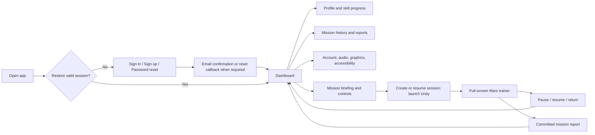

# Identity, game handoff and application navigation

## Android journey



Signup collects email/password through Supabase Auth and a minimal display alias. Show confirmation-pending state when the provider requires it. Password reset must include an approved app callback and a usable recovery screen; it is not merely a button sending email. Do not collect date of birth, precise location or health information for this demo.

Dashboard presents one playable mission, saved progress, the next recommended activity and a resume option. Incomplete missions must not appear completed. Settings include audio level, low/standard graphics, readable text, contrast-friendly markers and reduced motion. Confirm signout while a mission is active and offer save/return first.

## One session coordinator

The main-process host owns the Supabase session and refresh operation. Serialize refresh requests and atomically save the new refresh token before publishing the refreshed session. The Unity process must not initialize a second Auth client.

Persist an encrypted session record in app-private storage using a key protected by Android Keystore; Keystore protects keys, it is not a raw token database. Exclude the record from backups. Keep access tokens in memory where practical. Key invalidation, restore or corrupted storage returns the user to signin cleanly. Review the selected SDK's storage implementation rather than assuming its defaults meet this policy. [Android Keystore documentation](https://developer.android.com/privacy-and-security/keystore).

Supabase URL and publishable key can be client configuration. Database passwords, signing secrets, secret keys and service-role keys must remain server-side. [Supabase API key guidance](https://supabase.com/docs/guides/getting-started/api-keys).

The [Kotlin client is community-maintained](https://supabase.com/docs/reference/kotlin/introduction), although documented by Supabase. Its version, refresh behavior, callback handling and custom encrypted persistence need acceptance tests. Do not describe it as an official SDK or claim Android compatibility before compilation.

## Handoff without transferring credentials to Unity

```mermaid
sequenceDiagram
    participant H as Android host / broker
    participant A as Supabase Auth
    participant F as FastAPI
    participant U as Unity process
    H->>A: Signin or refresh
    A-->>H: Access JWT and rotated refresh token
    H->>F: Create mission session with Bearer access JWT
    F-->>H: Session ID, versioned configuration, revision
    H->>U: Launch ID and non-secret mission descriptor
    U->>H: Ready handshake through private IPC
    H-->>U: Mission snapshot and permitted controls
    U->>H: Typed decision, command ID, expected revision
    H->>F: Authorized mission command
    F-->>H: Canonical state and feedback
    H-->>U: Correlated response
    U->>H: Complete request
    H->>F: Validate and commit completion transaction
    F-->>H: Immutable report ID
    H-->>U: Completion receipt; allow return
    H->>H: Show refreshed dashboard/report
```

Launch descriptor: protocol version, launch UUID, mission-session UUID, mission/content/rubric versions, approved difficulty, quality preferences and initial state. Exclude passwords, JWTs, refresh tokens and email. Session IDs are identifiers, not bearer credentials.

The broker binds the launch to the current authenticated user and a specific session. It allows only mission operations; Unity cannot request arbitrary URLs, headers or account changes. HTTP requests use the host's short-lived access token. Small command envelopes have correlation IDs and bounded payloads. All input remains untrusted; FastAPI verifies ownership and valid transitions.

This is session continuity through an authenticated host broker, rather than a second Unity signin or custom permanent game token. Do not add a second identity provider. Avoid credentials in Intents, URLs, deep links, PlayerPrefs, logs, screenshots, analytics and build artifacts.

## API authorization and revocation

FastAPI must verify the Supabase JWT signature and allowed algorithm against the configured project's signing keys, plus issuer, expected audience, expiry and authenticated role; derive `user_id` from its validated `sub`. Reject anonymous users for saved training. Never authenticate by decoding alone or by trusting a body user ID. Use a fixed JWKS endpoint, bounded cache and a single refresh on unknown key IDs. For a legacy symmetric-signing project, use a supported Auth-server verification path until asymmetric signing is configured; do not ship its signing secret to clients. [Supabase JWT documentation](https://supabase.com/docs/guides/auth/jwts).

Refresh tokens rotate, so independent host/game refresh loops can race. Restore/refresh failures pause authenticated operations and route to signin without silently reassigning the mission. [Supabase session behavior](https://supabase.com/docs/guides/auth/sessions).

For explicit in-app signout, first ask FastAPI to revoke the current Auth `session_id` for training API access, then perform explicit local Supabase signout and erase storage. The backend checks its revocation ledger before serving protected calls. Abandon or pause active missions by documented user choice. Clear broker launch bindings and Unity state before another account signs in.

Supabase access JWTs can remain valid until expiry after signout. The training revocation ledger handles online signout through this app, not every external provider event automatically. If revocation cannot reach the backend, clear local credentials immediately and disclose that server-side revocation is pending/token-expiry bounded; do not claim instantaneous global logout. Remote logout/password recovery invalidation requires a separately validated provider-session check or short expiry window. Set the proposed access expiry to 10–15 minutes, verify project configuration, and do not invent a token TTL. [Supabase signout limitations](https://supabase.com/docs/guides/auth/signout).

## Lifecycle contract

| Event | Required behavior |
|---|---|
| Android Back | Game pause overlay: resume, save/return, or confirm abandon |
| Home/screen lock/focus loss | Pause input/audio and mission simulation; checkpoint at an allowed boundary |
| Network loss | Show offline state; local movement may continue, authoritative decisions/completion wait |
| Broker disconnect | Pause authenticated actions, reconnect with bounded retry, request canonical snapshot |
| Host process death | Restore encrypted Auth, verify session, rebind, reload server snapshot; no duplicate Auth clients |
| Unity process death | Dashboard offers resume; reload validated session and checkpoint |
| Account switch/signout | Invalidate launch ID and clear game state before new session |
| Completion response lost | Fetch existing report or retry same command ID; never award twice |
| Exit game | Wait for save receipt or explicitly show unsaved state; foreground host and test cleanup callback |

Unloading Unity does not promise complete memory release. Quitting ends the process hosting Unity; separate-process configuration must be verified so it does not end the dashboard. Use generated Unity lifecycle interfaces for this Editor version. Navigation recovery must also work when Android removes both processes. No seamless offline completion or untested crash-proof lifecycle claims are part of the MVP.
