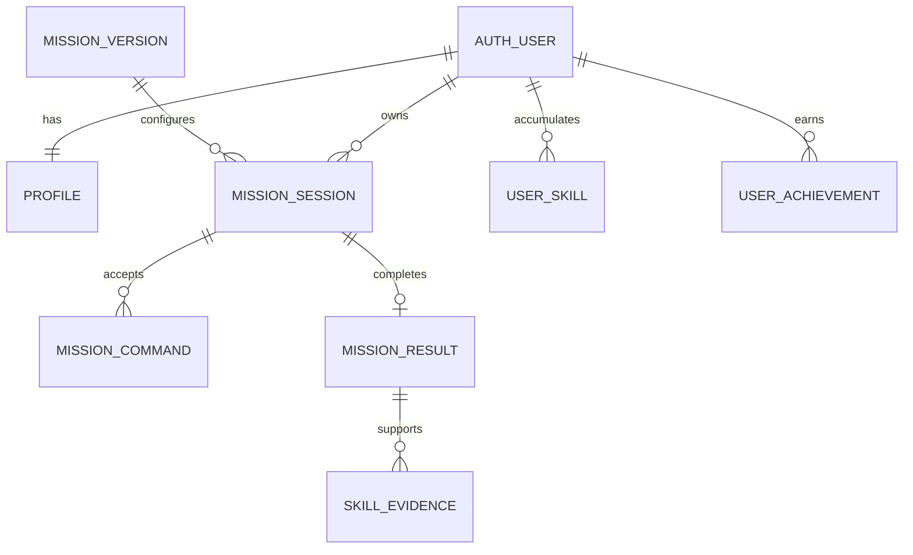

# Data model, API contracts and measurable learning

All tables and endpoints below are proposals. No SQL migrations, databases, API server or application code have been created.

## PostgreSQL boundary

Use one Supabase database. Keep application tables in a private `training` schema that is not exposed through the public Data API. Android, Unity and future web access application data through FastAPI. Supabase Auth retains its own managed user records.

FastAPI uses a dedicated non-owner database role with only required privileges and no `BYPASSRLS`; keep credentials in server environment configuration. Every user-data query must include the user identity derived from verified authorization, including nested resources. Use parameterized queries and transactions. Do not let a client set ownership or score fields.

Enable RLS as defense in depth on user-owned tables with default-deny access. The restricted backend role may use transaction-local identity context set only from the verified JWT for owner policies; policies and connection-pool context cleanup must be tested. Catalog reads have explicit grants. No frontend role can insert results, skill evidence or awards. Do not assume service-role/secret credentials are protected by RLS; they bypass it. [Supabase RLS](https://supabase.com/docs/guides/database/postgres/row-level-security) and [secure-data guidance](https://supabase.com/docs/guides/database/secure-data).

## Schema proposal

| Table | Key and essential fields | Ownership / constraints |
|---|---|---|
| profiles | user_id UUID → auth.users; display_alias, preferences, created_at, updated_at | One per user; no passwords or duplicated email; restrict editable fields |
| missions | mission_id + version; title, content_version, rubric_version, references, required_steps, difficulty_rules | Read-only published catalog; existing sessions retain pinned versions |
| mission_sessions | id UUID; user_id, auth_session_id, mission_id/version, difficulty, status, revision, canonical_state, timestamps | Owner only; active/paused/completed/abandoned state; optional one active session per mission/user |
| mission_commands | session_id + command_id UUID; expected_revision, kind, bounded payload, accepted_at, response | Unique pair enables idempotency; derives owner from session; server sequence |
| mission_results | session_id primary key; user_id, score, rubric_version, evidence_summary, feedback, completed_at | At most one immutable result per session; score bounds 0–100 |
| skill_evidence | session_id + skill_id; user_id, criterion outcomes, hints_used, attempts, evidence_strength | At most one contribution per skill/session; traceable to report |
| user_skills | user_id + skill_id; derived_level, evidence_count, updated_at | Recomputable cache; clients cannot write mastery |
| auth_session_revocations | auth_session_id primary key; user_id, revoked_at, expires_at | Server-only; bound retention to remaining credential validity |
| achievement_definitions | achievement_id; rule_version, criteria, label | Optional; authored server catalog |
| user_achievements | user_id + achievement_id; qualifying_session_id, awarded_at | Optional; unique award, server-only writes |

`canonical_state` is versioned, validated JSON containing explicit resource units and step state. It is not an arbitrary client snapshot. Foreign keys, score/resource checks and unique command/result constraints must be enforced in migrations later.

Completion is one database transaction: validate state → create result → create evidence → update skill cache → optionally award achievement → mark completed. Replayed completion returns the same report. Do not commit progress and assessment separately. Profile creation must also be idempotent after confirmed signin.

## FastAPI endpoint proposal

All `/v1` user endpoints require a validated Supabase access JWT. Supabase handles signup/signin/reset directly; FastAPI must not introduce its own password database or signin endpoint. Use documented request/response schemas and publish OpenAPI during implementation.

| Method and path | Purpose / request |
|---|---|
| GET /health | Public minimal availability; no configuration/secrets |
| GET /v1/me | Current profile or onboarding state |
| PATCH /v1/me | Whitelisted alias/preferences only |
| GET /v1/missions | Published missions and eligibility |
| GET /v1/recommendations | Deterministic next mission/difficulty and reason |
| POST /v1/mission-sessions | Mission ID/version request; server selects allowed difficulty; idempotency key |
| GET /v1/mission-sessions/{id} | Owner's canonical state, revision and resume status |
| POST /v1/mission-sessions/{id}/commands | commandId, expectedRevision, kind, validated payload |
| POST /v1/mission-sessions/{id}/pause | Idempotent command ID/revision; persist pause |
| POST /v1/mission-sessions/{id}/resume | Recheck Auth/ownership; canonical snapshot |
| POST /v1/mission-sessions/{id}/complete | Command ID/revision; server validates required evidence; returns report ID |
| POST /v1/mission-sessions/{id}/abandon | Explicit confirmed abandonment; no completion credit |
| GET /v1/reports/{sessionId} | Saved score, reasoning feedback, resource outcomes and next steps |
| GET /v1/progress | Dashboard summary and resumable mission |
| GET /v1/skills | Skill evidence count and provisional proficiency |
| GET /v1/history | Paginated mission reports |
| POST /v1/auth-session/revoke | Revoke the caller's current Auth session for training API access |
| GET /v1/achievements | Optional badges; add only after core completion |

Return 401 for invalid/expired authorization, 404 for nonexistent or other-user resources, 409 with canonical revision for state conflict, 422 for invalid decisions, and 429 for rate limits. A duplicate command ID with identical content returns the saved response; reuse with altered content fails. Put strict payload bounds and per-user/session rate limits on mutations. Reject invalid enums and unknown mission steps. Persist authoritative UTC times; never trust client clocks for energy or assessment.

Unity sends semantic actions such as inspect_panel, select_load_priority and classify_observation through the broker. It does not send a desired score or arbitrary resource total. Camera and movement run locally; no per-frame API traffic. The backend cannot prove every physical action in an untrusted client; this is an educational trainer, not certified anti-cheat or astronaut qualification.

## Science and resource simulation

Preserve the approved observe → predict → act → compare → explain sequence from the existing design documents. Core route remains Habitat → Power → Solar → Power → Science/Delta → advisory → Habitat/debrief. Do not replace the approved world layout during platform integration.

For the first mission, use the approved educational energy model: 20 kWh capacity, 12 kWh initial reserve, 4 kW clear generation, 1 kW dusty generation, 2 kW essential load, 1 kW research load. These are fictional training parameters, not measured Mars outpost values. Server computes energy change as net power × explicitly labeled forecast hours and clamps to capacity. A one-hour forecast is a lesson action; do not quietly treat one minute of play as an hour of real mission physics. Pause/background must not consume fictional life support while the user cannot act.

| STEM concept | MVP learning evidence | Expansion later |
|---|---|---|
| Energy generation | Predict kW versus kWh; choose essential loads; explain dust loss | Variable sun, batteries, multi-day planning |
| Engineering trade-offs | Balance reserve and research load; compare predicted/actual state | Maintenance and component failures |
| Scientific decision-making | Separate observed bedding from inferred history; record provenance | More samples, uncertainty and competing hypotheses |
| Oxygen | Suit readiness/reserve checklist; choose safe return over needless EVA | Validated oxygen/time model |
| Water recycling | Short authored recovery-loop decision in briefing/debrief | Consumables and mass-balance simulation |
| Radiation | Distinguish radiation risk from dust visibility; select shelter response | Validated dose model and exposure planning |
| Hydroponics | Explain water/light/power trade-off through one greenhouse learning card | Crop yield and closed-loop systems |

The last four are short assessed micro-decisions, not full gameplay systems. If time slips, clearly report which are informative cards and which have scored evidence. A visually visited greenhouse is not evidence of hydroponics mastery.

Use authored explanations linked to the existing design's scientific references. Record content/rubric/source versions in each report. Reviewer signs off each criterion; never label a fictional battery value, dust timer or difficulty multiplier as NASA data.

## Adaptive learning and assessment

MVP adaptation is deterministic, transparent and server-side. On the first attempt provide explicit hints and two decision choices. After demonstrated success, reduce scaffolding or add one load trade-off. After repeated mistakes, give a worked example and repeat an equivalent decision. Never increase radiation or lethal hazards merely to manufacture difficulty.

Proposed report rubric: energy/unit reasoning 35%, engineering decisions 25%, observation versus inference 25%, readiness/return reasoning 15%. Score criterion evidence, not walking speed; rubric weights are product assumptions requiring educational review. Record first-attempt outcome, hints and retries separately. UI reports strengths and one next learning action.

Keep a skill profile across energy, oxygen readiness, water systems, radiation awareness, hydroponics and scientific reasoning. Display “initial evidence” when there is only one short decision. Do not claim a validated proficiency threshold or certification. Optional levels can be provisional and evidence-count based, with minimum distinct sessions and later validation. Recommendations must cite the missing skill/evidence criterion, not an opaque invented AI score.
