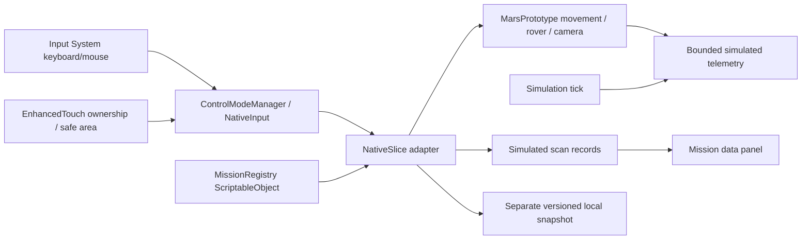

# Stage A architecture and dependency audit — 2026-10-13

Existing project Unity 6000.6.4f1, URP 17.6, Input System 1.20. Existing Mars controller handles walking/driving/weather/HUD/provisional events. Stage08C has finger ownership and safe-area controls but calls the gameplay object directly. Boarding hides the persistent astronaut; no explicit seat attachment. Mission01 first milestone has separate local onboarding/save. No existing central telemetry/registry/30-Sol/robot-upgrade implementation found in inspected sources.

First vertical slice adds adapters to a copied Mars scene. Original Mars and Mission01 scripts/scenes stay untouched. Existing locomotion/collision/weather/rover remain the simulation backend; native input uses a mode-aware input bus. Astronaut is attached to a seat, controller disabled while aboard, and safely detached on exit. Stable local agent IDs are not Supabase user identities.

Implement B–E only to the extent needed for the slice: configurable stable IDs; astronaut/rover modes; reused cameras; seating; telemetry and clock. H adds one synthetic scan and JSON/CSV local export. F/G/I/J remain planned: 30-Sol validated resource/research progression, robot upgrade/tuning models, ORBIS diagnostics and physical Android QA. Robot/cockpit/flight modes require explicit future implementations; do not simulate availability merely by changing a enum.

Save is local and provisional, not an authorized server outcome. Exports are operator/player-triggered, contain no account credentials and never upload automatically. Native share-sheet integration is deferred. No Supabase/backend/Auth changes.

Backups and hash manifest: work/nativecontrol/Backup and Before_Hashes.json. Validate in refreshed work/stage08b/PlayModeLab, then copy only new slice assets to the main project. Controlled tests are synthetic input, separate from real multitouch/Android tests.
