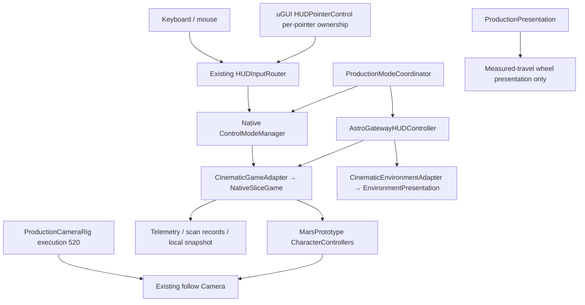

# Controller dependency map

Production modes are projections of existing driving, scan, pause and menu state plus one cinematic presentation flag. No duplicate astronaut or second physics controller is created. FutureRobot explicitly rejects requests. Scanner and cinematic modes use canonical Menu input lock; simulation time continues in cinematic view. Menu pauses through existing environment methods.

Old AdaptiveTouch and old OnGUI presentations are disabled/suppressed by the existing Cinematic adapters. The adapters suppress the old input poll while forwarding lifecycle to NativeSliceGame. Desktop and touch commands share the existing NativeInput contract. New camera reads existing yaw/pitch, and does not poll an additional orbit input source.

No controller deletion or source replacement. No independent wheel physics or boarding animation was added. Existing safe exit and stop-before-exit rules remain authoritative.
