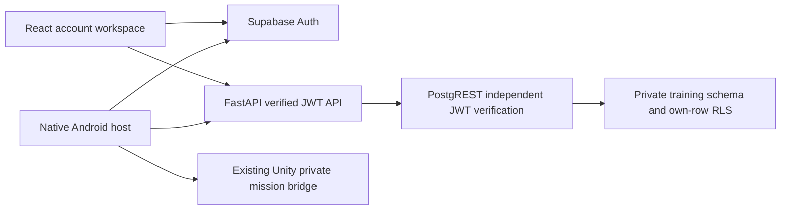

# Unified authentication architecture — 2026-10-11

## Local implementation complete; hosted acceptance BLOCKED

The canonical identity is Supabase Auth `auth.users.id` (UUID) from the approved test project `jvkwofmxtxjhdwtwdboz`. Web and Android use the same public project configuration. Display names are mutable and are not unique login handles. Email/password remain in Supabase Auth; no password column or independent account issuer is introduced.

FastAPI verifies the original bearer with the configured Auth server, checks issuer/audience/role/expiry/confirmed email, then forwards that original JWT to PostgREST. The gateway independently verifies its signature and applies native RLS. A user ID in a request body, header, local UI state or arbitrary PostgreSQL setting is never accepted as authorization proof. The retired direct database runtime role remains NOLOGIN. Valid stolen JWTs still carry their owner's authority until expiry/revocation.

## Data path

Unity receives only the existing versioned mission context, never passwords, access tokens or refresh tokens. The Unity bridge and approved Mars scenes were not changed. The Android export remains the integration-test scene, not the upgraded Mars scene.

Existing GET `/v1/me` and mission endpoints are preserved. The added POST `/v1/me/display-name` accepts one field and returns the same profile response model. POST avoids introducing an unsupported PATCH method into the existing Android HttpURLConnection transport.

Web uses official `@supabase/supabase-js`, PKCE email callbacks, persisted/automatically refreshed SDK sessions, server-verified users and profile ownership checks. Route protection requires a verified profile, not only local session presence. Profiles remain unavailable during password recovery. Logout invalidates pending loads and prevents refresh events from reopening a workspace while revocation is pending.

The root Mars preview and its original source remain intact, with `/mars` as an alias. `/welcome` is the new account entry point. No new mission simulation or telemetry is added.

## Local service isolation

[start_api.py](/Users/kapilash/Documents/Codex/2026-10-08/task-01-create-unity-6-urp/work/unifiedauth/start_api.py) launches an isolated source copy with a cleared, allowlisted environment and the existing macOS kernel confinement model. Only public project settings are copied; administrative `.env`, DB passwords, signing private keys, parent environment and trusted-code writes are denied. The service listens at 127.0.0.1:8000; the development Vite proxy is same-origin `/account-api`. Browser CORS was not widened, and the original backend owner-only private configuration was not edited or loaded into the service.

The established network confinement permits only the disposable local gateway. An attempted hostname-specific HTTPS rule was rejected by sandbox-exec and removed; no broad wildcard exception was substituted. Consequently, this preview server's `/health` proves startup/public configuration only. Hosted Auth/data access from this service is BLOCKED until an approved supported network/isolation arrangement is provided. Local integration uses an RSA fixture Auth transport and real local PostgREST, explicitly classified as rehearsal.

## Review sources

[Supabase PKCE flow](https://supabase.com/docs/guides/auth/sessions/pkce-flow), [code exchange](https://supabase.com/docs/reference/javascript/auth-exchangecodeforsession), [password recovery](https://supabase.com/docs/reference/javascript/auth-resetpasswordforemail). Existing Stage05B3 readiness remains a prerequisite; this work grants no remote execution approval.
